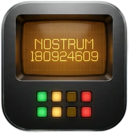
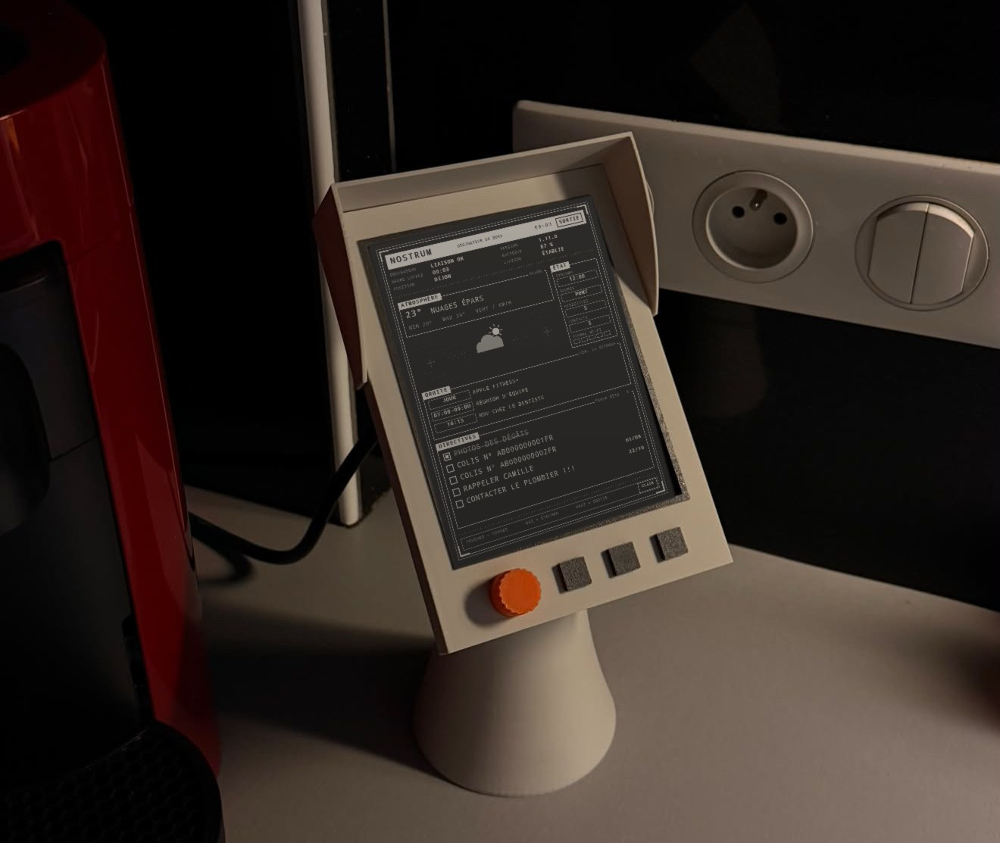
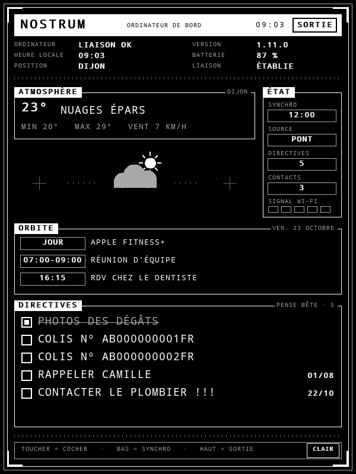
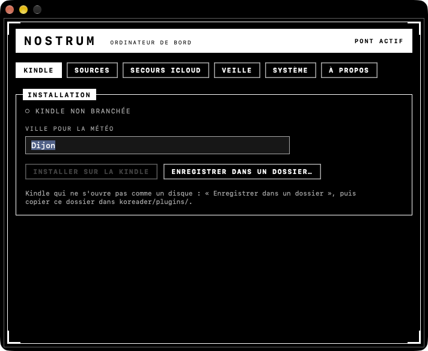

<p align="center"></p>

# NOSTRUM

*L'ordinateur de bord de votre journée.*

<p align="center">
  
</p>

## L'histoire

Tout est parti d'une vieille Kindle qui dormait dans un tiroir. Un écran à encre
électronique, ça ne fatigue pas les yeux, ça se lit de loin et ça tient des
semaines sur batterie. Ça méritait mieux que de prendre la poussière.

L'idée : en faire un écran de bord. Pas une tablette de plus, avec ses
notifications et ses lumières, mais un panneau calme posé dans la cuisine ou
sur le bureau. On passe devant, on lève les yeux, et on sait : il fait 23° et
le ciel se dégage, réunion à 7 h, dentiste à 16 h 15, et ce colis à
récupérer qu'on avait oublié.

Un collègue a dessiné et imprimé en 3D le support qui va avec : un pupitre
incliné, une visière, une molette orange et trois touches. La Kindle s'y glisse
et devient un petit terminal de bord, à mi-chemin entre la console de vaisseau
et l'objet de cuisine.

## Ce qu'on voit sur la Kindle

<p align="center">
  
</p>

- **La météo** de votre ville, en grand, avec le minimum, le maximum et le vent.
- **L'agenda du jour**, tiré de vos calendriers Apple.
- **Vos rappels** : un toucher suffit pour en cocher un, et il est coché aussi
  sur votre iPhone et votre Mac.
- **L'état de la liaison** : dernière synchronisation, batterie, Wi-Fi.

L'écran se met à jour tout seul. Quand la Kindle se met en veille, elle affiche
l'image de votre choix.

## Ce qu'on fait sur le Mac

<p align="center">
  
</p>

Le Mac fait le travail en coulisse. Une petite application lit votre agenda et
vos rappels, puis les envoie à la Kindle par le Wi-Fi de la maison. Ils ne
passent par aucun serveur extérieur.

On branche la Kindle une seule fois, on tape le nom de sa ville, on clique sur
**Installer sur la Kindle**. C'est tout. Ensuite, on choisit quels calendriers
et quelles listes de rappels apparaissent, et l'image de veille.

Si le Mac est éteint, la Kindle peut lire l'agenda directement sur iCloud
(réglage facultatif). Elle affiche alors « MAC ÉTEINT ».

## Pour l'installer

Il faut un Mac (macOS 12 ou plus récent) et une Kindle **déjà jailbreakée** avec
[KOReader](https://koreader.rocks). Nostrum ne s'occupe pas du jailbreak.

1. Téléchargez [**Nostrum.dmg**](https://github.com/david-guia/nostrum/releases/latest/download/Nostrum.dmg).
2. Glissez Nostrum dans Applications et ouvrez-la. Au premier lancement, macOS
   la bloque : passez par Réglages Système → Confidentialité et sécurité →
   *Ouvrir quand même*.
3. Branchez la Kindle et cliquez sur **Installer sur la Kindle**.

Le guide complet, pas à pas, est dans le DMG (`Lisez-moi.html`).

Nostrum est gratuit. Les mises à jour ne s'installent jamais seules : l'app
vous prévient quand une nouvelle version est disponible, vos réglages sont
conservés.

---

## Sous le capot

*Pour qui veut construire, modifier ou comprendre Nostrum.*

Agenda, rappels Apple et météo sur un Kindle jailbreaké (KOReader), servis par
une application Mac.

```
nostrum.koplugin/   plugin KOReader (ce qui tourne sur le Kindle)
pont/               application Mac, script de construction, guide client
dist/               sortie de pont/build.sh — Nostrum-<version>.dmg
```

### Construire le DMG

```
cd pont && ./build.sh
```

Contrôles du plugin, application universelle (arm64 + x86_64, macOS 12+) signée
(voir ci-dessous), plugin embarqué dans `Nostrum.app/Contents/Resources/nostrum.koplugin`,
puis `dist/Nostrum-<version>.dmg` (application + raccourci Applications +
`Lisez-moi.html`, le guide du client).

La version est celle de `local VERSION` en tête de `nostrum.koplugin/main.lua` :
un seul endroit, repris par le bandeau du Kindle, l'`Info.plist` et le nom du DMG.
Numérotation X.Y.Z : correction de bug → `1.3.1`, nouvelle fonctionnalité →
`1.4.0`, changement majeur → `2.0.0`.

**Sans compte Apple Developer** : l'application est signée avec le certificat
gratuit « Apple Development » mais n'est pas notarisée ; Gatekeeper bloque le
premier lancement. Le client passe par Réglages Système → Confidentialité et
sécurité → *Ouvrir quand même* (expliqué dans le guide). Le certificat donne une
identité stable : macOS garde l'accès aux Rappels quand le client remplace une
version par la suivante. Il expire au bout d'un an : le renouveler sous le même
nom. Sans certificat, `build.sh` signe en ad-hoc et macOS redemande ces accès à
chaque version.

### Fonctionnement

- **Mac** : l'app lit Rappels et Calendrier par EventKit et les sert sur le
  port 8843, protégés par un jeton tiré au premier lancement
  (`~/Library/Application Support/Nostrum/settings.json`, droits 600). Rangée
  dans Applications, elle s'inscrit au démarrage de session
  (`~/Library/LaunchAgents/me.davidguia.nostrum.plist`).
- **Installation sur le Kindle** : le bouton copie le plugin sur tout volume
  monté portant un dossier `koreader/` et écrit `config.lua` (jeton, adresses du
  Mac, ville géocodée par Open-Meteo). *Enregistrer dans un dossier…* fait de
  même pour les Kindle MTP qui ne montent pas comme un disque.
- **Kindle** : avec `bridge_token` et sans identifiants iCloud, agenda et
  tâches passent par le pont. Si aucune adresse ne répond, le Kindle balaie son
  /24 sur le port du pont (connexions TCP non bloquantes, 64 à la fois) et
  présente le jeton aux hôtes ouverts ; l'adresse trouvée est mémorisée. Au plus
  un balayage toutes les 5 minutes.
- **Mises à jour** : rien ne s'installe seul. Pour publier : changer
  `local VERSION` dans `main.lua`, committer, puis
  `pont/publier.sh`, qui construit et signe sur ce Mac, pousse les sources et
  crée la Release `vX.Y.Z` de ce dépôt avec `Nostrum.dmg`. L'app Mac lit la
  dernière Release (API GitHub) à chaque démarrage puis toutes les 6 h ; si
  elle est plus ancienne, elle propose de télécharger le DMG (alerte, puis
  bouton en bas de la fenêtre). Le Kindle compare sa version à celle du Mac à
  chaque synchro et, si elles diffèrent, propose d'installer celle du Mac
  (une fois par version et par session) puis de redémarrer KOReader.
- **Lien de téléchargement client** :
  https://github.com/david-guia/nostrum/releases/latest/download/Nostrum.dmg

**Secours iCloud (facultatif)** : dans l'app Mac, section *Agenda sans le Mac*,
identifiant Apple + mot de passe d'application. L'app les vérifie auprès
d'iCloud (`PROPFIND`, même requête que la Kindle), garde le mot de passe dans le
trousseau et l'écrit dans `config.lua` à l'installation (`username` /
`password`). La Kindle interroge toujours le pont d'abord ; s'il est hors
d'atteinte (une seule tentative par synchro), elle lit l'agenda sur iCloud en
CalDAV, garde les tâches déjà affichées et affiche `MAC ÉTEINT`, source
`ICLOUD`. Le menu garde la liste des calendriers apprise du Mac.

**Image de veille (facultatif)** : section *Écran de veille de la Kindle* de
l'app Mac. L'image (PNG, côté le plus long ≤ 1600 px) est rangée dans
`~/Library/Application Support/Nostrum/veille.png`, annoncée dans `/prefs`
(`screensaver = { id, size }`) et servie sur `/screensaver`. Le Kindle la
télécharge quand l'identifiant change, vérifie la taille, l'écrit dans
`koreader/data/screensaver/nostrum-veille.png` et règle KOReader dessus
(`screensaver_type = document_cover`). Sans image côté Mac, rien n'est touché.

### Contrôles

```
cd nostrum.koplugin
lua test.lua        # ics, caldav, météo, pont : agenda, bascule d'adresses, recherche réseau
lua render.lua | python3 render.py DroidSansMono.ttf apercu.png   # écran + synchro par le pont
```

Routes du pont : en-tête de `pont/nostrum-pont.swift`.

### Licence

MIT, voir `LICENSE`. La police `DroidSansMono.ttf`, utilisée seulement pour
l'aperçu de l'écran, reste sous licence Apache 2.0.
